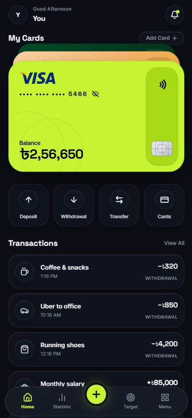
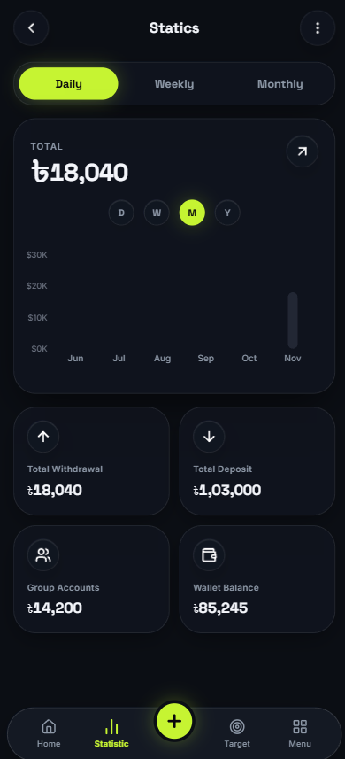

# Nova Expense

Nova Expense is a premium mobile-first fintech expense tracking web app built with React, TypeScript, Vite, TanStack Router, and Tailwind CSS. It brings accounts, transactions, budgets, bills, reports, and receipt scanning into a sleek dark obsidian glassmorphism interface.

## Screenshots

<p align="center">
  
  &nbsp;&nbsp;&nbsp;&nbsp;&nbsp;&nbsp;
  
</p>

## Highlights & Features

- **Interactive Stacked Card Deck:** Iconic Neon Lime (`#C6F432`) Visa card with deep black typography, official vector Visa branding, metallic golden EMV chip, and contactless waves `) ) )`. Back cards smoothly cycle to the front on click.
- **Glass Action Dock:** Quick-access monochrome action buttons on dark glass: **Deposit**, **Withdrawal**, **Transfer**, and **Cards**.
- **Contextual Transactions Feed:** Clean monochrome transaction items with smart contextual icons (Coffee, Car, ShoppingBag, Briefcase, etc.), clear amount signs, and timestamp details.
- **Dedicated "Statics" & Analytics:** Comprehensive analytics screen featuring Daily/Weekly/Monthly period tabs, glowing lime pill bar chart with Y-axis metrics, and a 2x2 financial summary grid.
- **5-Item Bottom Navigation Dock:** Dock with Home, Statistic, floating glowing lime Quick Add `+` action button, Target, and Menu drawer.
- **Mobile-first & PWA-ready:** App manifest, standalone support, safe-area insets, and smooth desktop wheel scrolling without scroll traps.
- **Account Management:** Multi-card and multi-wallet management with balance tracking, custom gradients, and masking.
- **Receipt Scanner & OCR:** Built-in camera/upload support with OCR-assisted detail extraction.
- **Budget Tracking & Smart Insights:** Real-time budget progress views, duplicate alerts, and spending breakdown.

## Tech Stack

- React 19
- TypeScript
- Vite 7
- TanStack Router
- TanStack React Query
- Tailwind CSS 4
- Radix UI primitives
- Lucide React icons
- Recharts
- Tesseract.js
- Firebase SDK
- React Hook Form
- Zod
- date-fns
- Sonner
- Embla Carousel
- Vaul
- Prettier
- ESLint

## Main Routes

```text
/                Dashboard
/add             Add transaction
/accounts        Accounts list and editor
/accounts/$id    Account detail
/transactions    Transaction history
/budgets         Budget tracking
/bills           Bill reminders
/events          Event ledgers
/reports         Reports and charts
/settings        App settings
```

Routes live in `src/routes/` and are wired through TanStack Router with `src/router.tsx` and `src/routeTree.gen.ts`.

## Project Structure

```text
nova-expense/
|-- public/              Static assets, manifest, and SPA redirects
|-- src/
|   |-- components/      App components and reusable UI blocks
|   |-- components/ui/   Shared Radix-style UI primitives
|   |-- hooks/           Reusable React hooks
|   |-- lib/             App utilities, categories, bills, OCR, and sync helpers
|   |-- routes/          Route-level screens
|   |-- App.tsx          App wrapper
|   |-- main.tsx         React entry point
|   |-- router.tsx       Router configuration
|   |-- routeTree.gen.ts Generated TanStack route tree
|   `-- styles.css       Tailwind theme and global styles
|-- index.html
|-- vite.config.js
|-- tsconfig.json
|-- eslint.config.js
`-- package.json
```

## Getting Started

Install dependencies:

```bash
npm install
```

Start the development server:

```bash
npm run dev
```

Open the local app:

```text
http://localhost:5173
```

Create a production build:

```bash
npm run build
```

Preview the production build:

```bash
npm run preview
```

Run linting:

```bash
npm run lint
```

Format files:

```bash
npm run format
```

## Scripts

- `npm run dev` starts the Vite development server
- `npm run build` creates a production build
- `npm run build:dev` creates a development-mode build
- `npm run preview` previews the production build
- `npm run lint` runs ESLint checks
- `npm run format` formats files with Prettier

## UI Approach

Nova Expense uses a dark glassmorphism interface with rounded cards, gradient accents, smooth mobile interactions, safe-area spacing, and compact controls. Tailwind CSS handles the visual system, while Radix UI primitives support accessible overlays, menus, tabs, forms, tooltips, and selection controls.

## Build And Deployment

Vite powers local development and production builds. The app is ready for static hosting and includes SPA fallback configuration through `public/_redirects` plus Vercel configuration in `vercel.json`.

## AI Receipt Scan

The receipt scanner runs local browser OCR first. If a server-side OpenAI key is configured, it then refines the receipt with AI vision and structured JSON extraction.

Set these server environment variables in your hosting provider:

```bash
OPENAI_API_KEY="sk-..."
OPENAI_RECEIPT_MODEL="gpt-4.1-mini"
```

Do not prefix the key with `VITE_`; it must stay server-only. On Vercel, the `/api/scan-receipt` function is available after deployment or when running with Vercel's local dev server.
